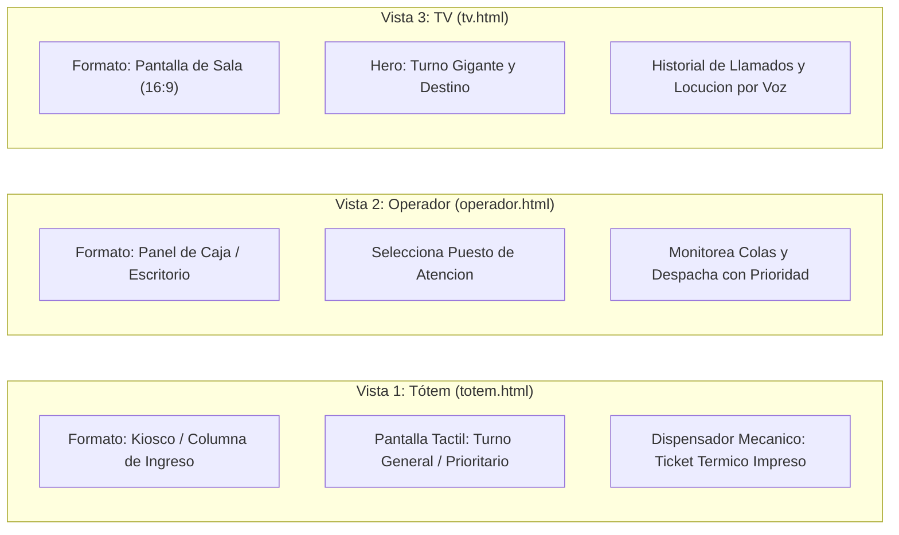
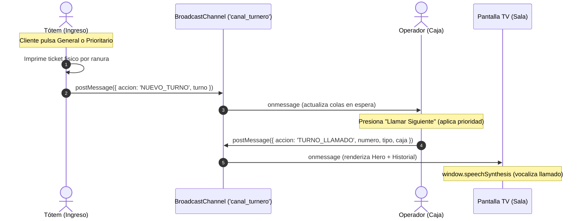

# 🏦 Sistema de Turnero Inteligente con Prioridad (Sala de Espera)

En este proyecto vamos a construir un sistema interactivo de turnos bancarios con atención prioritaria, compuesto por **tres interfaces independientes sincronizadas en tiempo real**:

1. **Tótem de autoservicio bancario (`totem.html`):** Simulador de la columna física de ingreso a la sucursal, con pantalla táctil integrada y ranura dispensadora mecánica de donde emerge el ticket impreso.
2. **Panel del operador (`operador.html`):** Interfaz para el cajero o representante bancario, donde elige su puesto/caja y despacha los turnos aplicando prioridad.
3. **Pantalla de sala de espera (`tv.html`):** Formato TV horizontal (16:9) con tipografía gigante, caja asignada, distintivo de prioridad, historial y locución por voz.

El objetivo pedagógico es aprender a diseñar experiencias de usuario contextualizadas para cada tipo de pantalla y resolver la lógica de colas con prioridad, sincronización multi-pantalla y síntesis de voz usando **JavaScript Vanilla** asistido por Inteligencia Artificial.

El trabajo se realiza con **baby steps**: una funcionalidad pequeña y concreta por vez, verificándola antes de avanzar al siguiente paso.

---

## Las tres vistas del proyecto



La comunicación entre las tres pestañas se realiza en tiempo real y sin necesidad de un backend ni dependencias externas, aprovechando la API nativa **`BroadcastChannel`** del navegador.

---

## Estructura de archivos

```text
turnera-bancos/
├── index.html         -> Portada institucional y lanzador de las vistas
├── style-index.css    -> Estilos de la portada principal
├── demo.html          -> Simulador integrado en vivo (iframes con foco e iluminación perimetral)
├── style-demo.css     -> Estilos del simulador con halo activo (Glow)
├── demo.js            -> Controlador del guión automático y relato en tiempo real
├── totem.html         -> Tótem de autoservicio bancario (pantalla táctil y dispensador)
├── operador.html      -> Panel del empleado para despachar turnos
├── tv.html            -> Pantalla de sala de espera (vista TV 16:9)
├── style-totem.css    -> Estilos de columna física y ranura de ticket
├── style-operador.css -> Estilos funcionales para estación de trabajo/caja
├── style-tv.css       -> Estilos para pantalla grande y visión a distancia
├── totem.js           -> Emite turnos e imprime físicamente el ticket térmico
├── operador.js        -> Administra colas con prioridad y llama al siguiente
└── tv.js              -> Recibe llamados, actualiza pantalla y reproduce voz
```

---

## Cómo ejecutar el proyecto

Para que la comunicación por `BroadcastChannel` funcione correctamente entre pestañas o ventanas separadas, los archivos deben estar servidos bajo el mismo origen (`http://localhost:...`) y no mediante el protocolo directo `file://`.

La forma más sencilla y recomendada es utilizar **Visual Studio Code**:

1. Instalá la extensión **Live Server** (de *Ritwick Dey*) desde el panel de Extensiones de VS Code (`Ctrl + Shift + X`).
2. Hacé clic derecho sobre el archivo `index.html` en el explorador de archivos.
3. Seleccioná **"Open with Live Server"** (o hacé clic en el botón **"Go Live"** en la barra inferior azul de VS Code).
4. Se abrirá automáticamente tu navegador predeterminado en `http://127.0.0.1:5500/index.html`.

Desde la portada podés:
1. **Ver la Demostración Automática Integrada:** `demo.html` (muestra las 3 pantallas en simultáneo mediante iframes, con narrador en vivo e iluminación perimetral activa).
2. **Abrir cada vista por separado en pestañas individuales:**
   - **Tótem (Autoservicio):** `totem.html`
   - **Operador (Caja):** `operador.html`
   - **Pantalla TV (Sala):** `tv.html`

---

## Flujo del sistema



1. **El cliente** ingresa a la sucursal y en la pantalla táctil del **Tótem de autoservicio** elige *"Turno General"* o *"Turno Prioritario"*. El tótem imprime su ticket térmico por la ranura y emite el evento al canal.
2. **El operador** ve actualizarse los contadores de espera en su panel. Al presionar *"Llamar Siguiente"*, el sistema atiende primero a los turnos prioritarios. Al despachar, emite el turno convocado junto a su caja (ej. `Caja 2`).
3. **La pantalla de TV** recibe el turno llamado, lo muestra en grande en la zona principal, pasa el anterior al historial de llamados y reproduce la locución de voz en español.

---

## Cómo trabajar con los prompts

No le pidas a la IA que construya todo el sistema de una sola vez. Copiá un prompt por vez, revisá las modificaciones sugeridas, probalas en el navegador y recién después continuá con el siguiente.

Antes de cada paso, compartí el código de los archivos involucrados para que la IA trabaje sobre la base existente en lugar de sobreescribirla por completo.

### Reglas generales de código y maquetación
- **Grid:** Utilizar CSS Grid para el layout general y la estructura contenedora de cada vista.
- **Flexbox:** Utilizar Flexbox exclusivamente dentro de los componentes internos (tarjetas, botones, headers, badges).
- **Colores directos:** Definir colores en formato hexadecimal o RGB directamente en las reglas CSS (sin variables CSS `:root` / `var(...)`).
- **Unidades de medida:** Emplear únicamente `px` y `%` para dimensiones, espaciados y tipografías (sin `rem`, `em`, `vh`, `vw`).
- **Responsividad:** Diseñar interfaces adaptables mediante Media Queries estándar con puntos de quiebre en `px`.
- **JavaScript Vanilla:** Sin librerías, dependencias ni frameworks externos.
- **Nomenclatura y separación:** Respetar los nombres de clases e IDs acordados y mantener separados HTML, CSS y JS.
- **Comentarios:** Explicar conceptos clave y lógica de negocio con comentarios concisos en el código.

---

## Guía Pedagógica Paso a Paso (Prompts Atómicos)

Seguí este camino de desarrollo incremental (*baby steps*). Cada paso aborda una única funcionalidad pequeña y concreta, fácil de probar y verificar antes de continuar.

---

### Paso 1: Maquetación del Tótem en grilla 2x2 y ranura dispensadora (`totem.html` y `style-totem.css`)

```text
Actuá como desarrollador frontend.
Quiero maquetar la estructura de un tótem bancario físico en totem.html y style-totem.css.
- Chasis central vertical (#totem-chassis) con cabezal, reloj e indicador LED.
- Pantalla táctil con 4 botones de servicio en grilla 2x2 (CSS Grid de 2 columnas):
  1. "Atención Prioritaria" (P-XX)
  2. "Operaciones por Caja" (C-XX)
  3. "Tarjetas y Cuentas" (T-XX)
  4. "Asesoría y Créditos" (A-XX)
- Una ranura mecánica inferior (#dispenser-slot) con un ticket térmico (#ticket-impreso) preparado para emerger.
- Reglas: CSS Grid para el layout general, Flexbox para los componentes internos, medidas en px y %, colores directos sin variables CSS.
```

#### Comprobar
- Al abrir `totem.html`, se ve el tótem con estilo institucional y sus 4 botones distribuidos en una matriz prolija de 2x2.
- Debajo se observa la ranura física del dispensador.

---

### Paso 2: Contadores independientes y animación del ticket térmico (`totem.js` y `style-totem.css`)

```text
En totem.js y style-totem.css, implementemos la generación del ticket impreso:
1. Declarar 4 contadores en memoria: contadorPrioritario, contadorCaja, contadorTarjetas y contadorCreditos.
2. Al pulsar cualquiera de los 4 botones:
   - Incrementar su contador y formatear el código (ej. P-01, C-01, T-01, A-01).
   - Actualizar el contenido del ticket (#ticket-numero, #ticket-servicio, fecha y hora).
   - Asignar el badge correspondiente (Prioritario o General).
3. En style-totem.css, crear una animación @keyframes print-ticket para que el ticket descienda visualmente saliendo de la boca mecánica.
```

#### Comprobar
- Al hacer clic en cualquier servicio, el ticket térmico emerge animadamente por la ranura con el código correlativo y la fecha/hora actual.

---

### Paso 3: Emisión de turnos por BroadcastChannel (`totem.js`)

```text
En totem.js, conectemos el tótem al canal nativo de comunicación entre pantallas:
1. Instanciar const canal = new BroadcastChannel('canal_turnero');
2. Dentro de la función emitirTurno(), además de renderizar el ticket, enviar el mensaje al canal:
   canal.postMessage({
     accion: 'NUEVO_TURNO',
     turno: { numero, tipo, servicio, prefijo, fecha, hora }
   });
3. Mantener el reloj digital del cabezal actualizado en vivo cada segundo.
```

#### Comprobar
- Al emitir un turno en `totem.html`, abrí la consola del navegador (`F12`) en otra pestaña y verificá que el evento `NUEVO_TURNO` llega con el objeto completo.

---

### Paso 4: Panel del Operador y telemetría de 4 colas (`operador.html` y `operador.js`)

```text
Vamos a construir el panel de atención en operador.html y operador.js:
1. La pantalla debe incluir:
   - Selector de puesto (#select-caja: "Caja 1", "Caja 2", "Box 1", "Box 2").
   - 4 tarjetas de telemetría para ver la cantidad en espera de cada cola: Prioritaria, Caja, Tarjetas y Asesoría.
   - Botón destacado #btn-llamar ("Llamar Siguiente Turno").
   - Recuadro del turno actualmente en atención.
2. En operador.js, conectar a 'canal_turnero' y almacenar 4 arrays en memoria:
   colaPrioritaria, colaCaja, colaTarjetas y colaAsesoria.
3. Al recibir un mensaje con accion === 'NUEVO_TURNO', clasificar el turno en el array correspondiente y refrescar los 4 contadores en pantalla.
```

#### Comprobar
- Abrí `totem.html` y `operador.html` en dos ventanas contiguas.
- Al pulsar botones en el tótem, los contadores respectivos de `operador.html` se incrementan al instante en tiempo real.

---

### Paso 5: Despacho con regla de prioridad absoluta y afinidad (`operador.js`)

```text
En operador.js, programemos el clic de #btn-llamar aplicando las reglas de negocio del banco:
1. Regla 1 (Prioridad absoluta): Si colaPrioritaria tiene turnos pendientes, extraer siempre el primero con shift(), sin importar qué puesto esté llamando.
2. Regla 2 (Afinidad de puesto): Si no hay prioritarios:
   - "Caja 1" y "Caja 2" atienden colaCaja.
   - "Box 1" atiende colaTarjetas.
   - "Box 2" atiende colaAsesoria.
   - Si la cola propia está vacía, atender turnos de cualquier otra cola disponible.
3. Si todas las colas están vacías, advertir en pantalla que no hay clientes en espera.
4. Mostrar en pantalla el turno extraído y actualizar los contadores.
```

#### Comprobar
- Emití en el tótem un turno de Caja (`C-01`), luego uno de Tarjetas (`T-01`) y al final uno Prioritario (`P-01`).
- Al presionar "Llamar Siguiente", el operador debe despachar obligatoriamente a `P-01` en primer lugar.

---

### Paso 6: Comunicación del llamado a la sala (`operador.js`)

```text
En operador.js, al despachar exitosamente un turno:
1. Publicar el llamado al canal de comunicación:
   canal.postMessage({
     accion: 'TURNO_LLAMADO',
     numero: turno.numero,
     tipo: turno.tipo,
     servicio: turno.servicio,
     caja: puestoSeleccionado,
     hora: new Date().toLocaleTimeString().substring(0, 5)
   });
2. Actualizar el panel de "Turno en Atención" con el número, el servicio y la hora.
```

#### Comprobar
- Al llamar un turno en `operador.html`, verificá en consola o en una pestaña oyente que se recibe la acción `TURNO_LLAMADO` con el turno y el puesto asignado.

---

### Paso 7: Pantalla TV de sala - Render monumental (Hero) e Historial (`tv.html`, `style-tv.css`, `tv.js`)

```text
En tv.html, style-tv.css y tv.js:
1. Diseñar un layout horizontal 16:9 con CSS Grid:
   - Zona Principal (Hero monumental, 65% del ancho): muestra el turno convocado en tamaño gigante (#tv-numero), el nombre del servicio, el puesto de destino (#tv-destino) y el badge de categoría.
   - Zona Lateral (Historial, 35% del ancho): lista con los últimos turnos llamados.
2. En tv.js, escuchar mensajes con accion === 'TURNO_LLAMADO':
   - Trasladar el turno previo al array historialLlamados (máximo 4 elementos).
   - Renderizar el nuevo turno en la zona Hero.
   - Agregar una clase CSS temporal 'animar-llamado' para producir un parpadeo/pulso visual cada vez que entra un nuevo turno.
```

#### Comprobar
- Al presionar "Llamar Siguiente" en el operador, la pantalla de TV parpadea y actualiza el turno grande y su destino.
- El llamado anterior se desplaza fluidamente al historial lateral.

---

### Paso 8: Síntesis de voz institucional en la TV (`tv.js` y `tv.html`)

```text
Agreguemos locución por voz en la pantalla de TV (tv.js):
1. Crear la función vocalizarLlamado(numero, puesto):
   - Frase a reproducir: "Turno [numero], dirigirse a [puesto]".
   - Usar SpeechSynthesisUtterance con idioma español ('es-AR' o 'es-ES') y velocidad clara (rate = 0.9).
   - Cancelar locuciones previas con window.speechSynthesis.cancel() y ejecutar speak().
2. En tv.html, incluir un botón flotante discreto #btn-audio ("Activar Audio de Sala"). Al ser pulsado por primera vez, habilita la síntesis de voz del navegador (superando el bloqueo de autoplay) y se oculta.
```

#### Comprobar
- Pulsá "Activar Audio de Sala" en la TV.
- Al despachar un turno desde el operador, la TV pronuncia en español claro: *"Turno P-01, dirigirse a Caja 2"*.

---

### Paso 9 (Opcional): Simulador integrado multi-pantalla con halo perimetral (`demo.html`)

```text
Para demostraciones o presentaciones pedagógicas sin múltiples pestañas:
1. Crear demo.html con un CSS Grid asimétrico (32% | 33% | 35%) conteniendo 3 iframes:
   - Columna 1: totem.html
   - Columna 2: operador.html
   - Columna 3: tv.html
2. Diseñar un sistema de iluminación perimetral activa (Glow):
   - Cuando una pantalla ejecuta una acción, su borde perimetral se ilumina con un halo de color brillante (Azul para tótem, Verde para operador, Ámbar para TV).
3. En demo.js, programar un guión automático de 7 pasos que simule el flujo completo de clientes, atención prioritaria y TV con un narrador superior en tiempo real.
```

#### Comprobar
- Al abrir `demo.html` y pulsar "Iniciar Demostración", el narrador relata cada acción mientras el foco luminoso se desplaza secuencialmente entre el Tótem, el Operador y la TV.

---

## 🏆 Desafíos Extra (Nivel Pro)

Si ya completaste el flujo base y querés llevar el proyecto al siguiente nivel, acá tenés 6 desafíos técnicos para resolver con JavaScript Vanilla asistido por IA:

### 1. Campanilla "Ding-Dong" institucional antes de hablar (Web Audio API)
* **Objetivo:** En los bancos y aeropuertos, la TV emite un acorde característico (*ding-dong* de dos tonos) que capta la atención del salón antes de que la voz hable.
* **Reto técnico:** Sin descargar archivos `.mp3` externos. Usar la API nativa `AudioContext` de JavaScript para sintetizar dos notas puras consecutivas (ej. Mi `659 Hz` seguida de Do `523 Hz`) durante `0.8s` y secuenciarlo antes de `window.speechSynthesis.speak()`.

```text
Prompt de ayuda:
"En tv.js, creá una función reproducirDingDong() usando Web Audio API nativo (AudioContext) sin archivos de audio externos. Debe generar un acorde de dos tonos suaves y armónicos que suene durante 800ms. Hacé que vocalizarLlamado() espere a que termine el ding-dong antes de disparar el sintetizador de voz."
```

---

### 2. Gestión de "Turno Ausente" y "Re-llamado" (Terminal del Operador)
* **Objetivo:** Si un cliente convocado no se acerca a la caja en 30 segundos, el operador debe poder volver a llamarlo o marcarlo como ausente.
* **Reto técnico:** Agregar botones *"Re-llamar"* (repite el anuncio en la TV sin alterar la cola) y *"Marcar Ausente"*. Al marcar ausente, el turno pasa a una lista secundaria de "Ausentes recuperables" por 5 minutos antes de descartarse definitivamente.

```text
Prompt de ayuda:
"En operador.html y operador.js, agregá los botones 'Re-llamar' y 'Marcar Ausente'. Al re-llamar, reenviar el evento TURNO_LLAMADO a la TV. Al marcar ausente, mover el turno a un array turnosAusentes con un temporizador de expiración y permitir que el operador pueda restaurarlo a la cola si el cliente reaparece."
```

---

### 3. Estimador de Tiempo de Espera en el Ticket Térmico (Tótem)
* **Objetivo:** Que el cliente sepa cuántos minutos aproximados tendrá de espera al recibir el ticket.
* **Reto técnico:** Calcular el tiempo multiplicando la cantidad de personas por delante en esa cola por el promedio histórico del servicio (ej. Caja: 3 min por persona; Créditos: 10 min por persona). Imprimir en el ticket: *"Tiempo estimado: ~9 min (3 personas antes que usted)"*.

```text
Prompt de ayuda:
"En totem.js, consultá la cantidad de turnos acumulados antes de emitir e imprimí en el ticket térmico una línea con el tiempo de espera estimado en minutos, asumiendo 3 min para Caja y 8 min para Asesoría."
```

---

### 4. Persistencia anti-recargas con `localStorage` (Protección contra F5)
* **Objetivo:** Si el operador o el tótem recargan accidentalmente la pestaña, el sistema no debe perder los turnos acumulados ni volver los contadores a `01`.
* **Reto técnico:** Guardar el estado de las 4 colas y los contadores en `localStorage` ante cada mutación, hidratar el estado al iniciar y proveer un botón de "Cierre de Jornada / Reiniciar a Cero".

```text
Prompt de ayuda:
"En operador.js y totem.js, implementá persistencia de las colas y los contadores usando localStorage con JSON.stringify. Al recargar la página, recuperá el estado previo para no perder la numeración ni los turnos en espera."
```

---

### 5. Modo "Móvil / Seguimiento por QR" en el Teléfono
* **Objetivo:** Permitir que el cliente escanee un código QR en el ticket para ir a un café cercano y ver desde su celular cuántos turnos le faltan.
* **Reto técnico:** Diseñar una vista ultraligera `cliente.html?turno=C-04` que escuche el `BroadcastChannel` y muestre en tiempo real: *"Turnos por delante: 2"*, cambiando a color verde y vibrando (`navigator.vibrate`) cuando la caja lo convoca.

```text
Prompt de ayuda:
"Creá cliente.html con diseño móvil que lea el parámetro de la URL (URLSearchParams) para saber qué turno tiene el usuario. Conectalo a 'canal_turnero' para calcular cuántos turnos faltan para su llamado y alertarlo con vibración y color cuando su número aparezca en pantalla."
```

---

### 6. Tablero de Métricas y Productividad de Sucursal (`metricas.html`)
* **Objetivo:** Proveer al gerente del banco un panel de control para auditar el rendimiento del día.
* **Reto técnico:** Una vista que calcule: total de clientes atendidos, tiempo promedio de atención por puesto y un gráfico de barras horizontal en CSS puro (con porcentajes de ancho) que compare el volumen de cada uno de los 4 servicios bancarios.

```text
Prompt de ayuda:
"Creá metricas.html con un panel dashboard que escuche los eventos del canal y registre: total de atendidos por servicio, tiempo promedio entre emisión y llamado, y una gráfica de barras en CSS puro (sin Chart.js) comparando la demanda de los 4 servicios."
```
