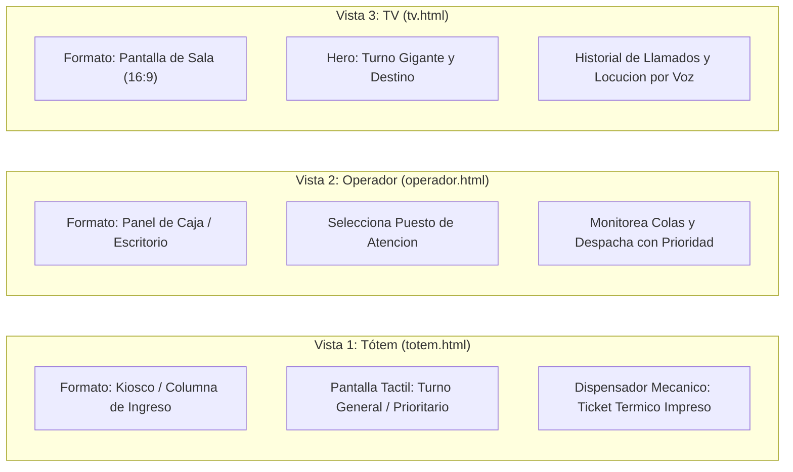
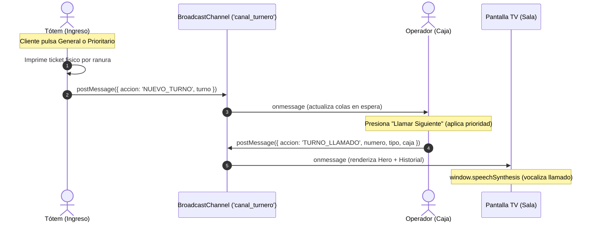

# 🏦 Sistema de Turnero Inteligente con Prioridad (Sala de Espera)

En este proyecto vamos a construir un sistema interactivo de turnos bancarios con atención prioritaria, compuesto por **tres interfaces independientes sincronizadas en tiempo real**:

1. **Tótem de autoservicio bancario (`totem.html`):** Simulador de la columna física de ingreso a la sucursal, con pantalla táctil integrada y ranura dispensadora mecánica de donde emerge el ticket impreso.
2. **Panel del operador (`operador.html`):** Interfaz para el cajero o representante bancario, donde elige su puesto/caja y despacha los turnos aplicando prioridad.
3. **Pantalla de sala de espera (`tv.html`):** Formato TV horizontal (16:9) con tipografía gigante, caja asignada, distintivo de prioridad, historial y locución por voz.

El objetivo pedagógico es aprender a diseñar experiencias de usuario contextualizadas para cada tipo de pantalla y resolver la lógica de colas con prioridad, sincronización multi-pantalla y síntesis de voz usando **JavaScript Vanilla** asistido por Inteligencia Artificial.

El trabajo se realiza con **baby steps**: una funcionalidad pequeña y concreta por vez, verificándola antes de avanzar al siguiente paso.

---

## Las tres vistas del proyecto



La comunicación entre las tres pestañas se realiza en tiempo real y sin necesidad de un backend ni dependencias externas, aprovechando la API nativa **`BroadcastChannel`** del navegador.

---

## Estructura de archivos

```text
turnera-bancos/
├── index.html         -> Portada institucional y lanzador de las 3 vistas
├── style-index.css    -> Estilos de la portada principal
├── totem.html         -> Tótem de autoservicio bancario (pantalla táctil y dispensador)
├── operador.html      -> Panel del empleado para despachar turnos
├── tv.html            -> Pantalla de sala de espera (vista TV 16:9)
├── style-totem.css    -> Estilos de columna física y ranura de ticket
├── style-operador.css -> Estilos funcionales para estación de trabajo/caja
├── style-tv.css       -> Estilos para pantalla grande y visión a distancia
├── totem.js           -> Emite turnos e imprime físicamente el ticket térmico
├── operador.js        -> Administra colas con prioridad y llama al siguiente
└── tv.js              -> Recibe llamados, actualiza pantalla y reproduce voz
```

---

## Cómo ejecutar el proyecto

Para que la comunicación por `BroadcastChannel` funcione correctamente entre pestañas o ventanas separadas, deben estar servidas bajo el mismo origen.

Iniciá un servidor local desde la carpeta del proyecto:

```bash
python3 -m http.server 8000
```

Luego visitá en tu navegador:
* **Portada Principal:** `http://localhost:8000/` (o `index.html`)

Desde la portada podés:
1. Abrir cada vista en una pestaña nueva con su respectivo botón:
   - **Tótem (Autoservicio):** `totem.html`.
   - **Operador (Caja):** `operador.html`.
   - **Pantalla TV:** `tv.html`.
2. O pulsar **"Abrir las 3 Vistas en Pestañas Nuevas"** para lanzarlas todas juntas con un solo clic.

---

## Flujo del sistema



1. **El cliente** ingresa a la sucursal y en la pantalla táctil del **Tótem de autoservicio** elige *"Turno General"* o *"Turno Prioritario"*. El tótem imprime su ticket térmico por la ranura y emite el evento al canal.
2. **El operador** ve actualizarse los contadores de espera en su panel. Al presionar *"Llamar Siguiente"*, el sistema atiende primero a los turnos prioritarios. Al despachar, emite el turno convocado junto a su caja (ej. `Caja 2`).
3. **La pantalla de TV** recibe el turno llamado, lo muestra en grande en la zona principal, pasa el anterior al historial de llamados y reproduce la locución de voz en español.

---

## Cómo trabajar con los prompts

No le pidas a la IA que construya todo el sistema de una sola vez. Copiá un prompt por vez, revisá las modificaciones sugeridas, probalas en el navegador y recién después continuá con el siguiente.

Antes de cada paso, compartí el código de los archivos involucrados para que la IA trabaje sobre la base existente en lugar de sobreescribirla por completo.

### Reglas generales de código y maquetación
- **Grid:** Utilizar CSS Grid para el layout general y la estructura contenedora de cada vista.
- **Flexbox:** Utilizar Flexbox exclusivamente dentro de los componentes internos (tarjetas, botones, headers, badges).
- **Colores directos:** Definir colores en formato hexadecimal o RGB directamente en las reglas CSS (sin variables CSS `:root` / `var(...)`).
- **Unidades de medida:** Emplear únicamente `px` y `%` para dimensiones, espaciados y tipografías (sin `rem`, `em`, `vh`, `vw`).
- **Responsividad:** Diseñar interfaces adaptables mediante Media Queries estándar con puntos de quiebre en `px`.
- **JavaScript Vanilla:** Sin librerías, dependencias ni frameworks externos.
- **Nomenclatura y separación:** Respetar los nombres de clases e IDs acordados y mantener separados HTML, CSS y JS.
- **Comentarios:** Explicar conceptos clave y lógica de negocio con comentarios concisos en el código.

---

## Prompt 1: Emisión física de turnos en el tótem de autoservicio (`totem.html` y `totem.js`)

```text
Actuá como desarrollador frontend trabajando con JavaScript Vanilla.
Tengo el archivo totem.html maquetado con la estructura de un tótem bancario físico (pantalla táctil y ranura dispensadora) y su archivo totem.js.

Necesito programar la lógica del tótem para dispensar un turno:
1. Mantener dos contadores independientes autoincrementales en memoria: uno para turnos generales (inicia en 1) y otro para prioritarios (inicia en 1).
2. Al pulsar el botón #btn-general:
   - Generar el código "G-01", "G-02", etc. (con dos dígitos).
   - Crear un objeto con el turno: { numero: "G-01", tipo: "General", fecha: new Date().toLocaleDateString(), hora: new Date().toTimeString().substring(0, 5) }.
   - Renderizar el ticket térmico impreso (#ticket-impreso) que emerge de la ranura dispensadora con el número asignado, fecha, hora y código de barras.
3. Al pulsar el botón #btn-prioritario:
   - Generar el código "P-01", "P-02", etc.
   - Crear el objeto correspondiente con tipo "Prioritario" y mostrar el ticket con su badge distintivo de prioridad.
4. Conectar con un canal de BroadcastChannel llamado 'canal_turnero' y enviar un mensaje cada vez que se genera un turno:
   canal.postMessage({ accion: 'NUEVO_TURNO', turno });
5. Programar el botón #btn-nuevo-ticket para simular que el cliente retiró el ticket impreso de la boca del dispensador.

Escribí el código para totem.js con comentarios claros y directos.
```

### Comprobar
- Al presionar cada botón en `totem.html`, el ticket físico desciende animadamente por la ranura con el código correlativo de dos dígitos.
- En la consola del navegador se verifica el envío del mensaje por el `BroadcastChannel`.

---

## Prompt 2: Recepción de colas y llamado prioritario en el panel del operador (`operador.html` y `operador.js`)

```text
Continuamos con la vista del empleado de atención en operador.html y su script operador.js.

La interfaz del operador cuenta con:
- Un selector #select-caja con opciones ("Caja 1", "Caja 2", "Box 3").
- Un panel indicador de espera (#contador-general y #contador-prioritario).
- Un botón principal #btn-llamar ("Llamar Siguiente").
- Un área para mostrar el turno que el operador está atendiendo actualmente (#turno-actual).

Implementá la lógica en operador.js:
1. Conectar al mismo 'canal_turnero' mediante BroadcastChannel.
2. Mantener dos arrays en memoria: colaGeneral y colaPrioritaria.
3. Al recibir un mensaje con accion === 'NUEVO_TURNO', agregar el turno a la cola correspondiente según su tipo y actualizar los contadores en pantalla.
4. Al hacer clic en #btn-llamar:
   - Si ambas colas están vacías, mostrar un mensaje de aviso en pantalla indicando que no hay clientes en espera.
   - Si hay turnos en colaPrioritaria, extraer el primero (shift()).
   - Si colaPrioritaria está vacía pero hay en colaGeneral, extraer el primero de colaGeneral.
   - Obtener la caja seleccionada en #select-caja.
   - Actualizar el área #turno-actual en el panel del operador.
   - Emitir al canal un mensaje con accion === 'TURNO_LLAMADO':
     canal.postMessage({ accion: 'TURNO_LLAMADO', numero: turno.numero, tipo: turno.tipo, caja: cajaSeleccionada });
   - Actualizar los contadores de espera.

Mantené el código modular, sin librerías externas y comentado.
```

### Comprobar
- Cuando se emite un turno desde `cliente.html`, los contadores de `operador.html` aumentan automáticamente sin recargar.
- Al pulsar "Llamar Siguiente", los turnos prioritarios se atienden siempre antes que los generales.
- Al despachar, el evento `TURNO_LLAMADO` se publica en el `BroadcastChannel`.

---

## Prompt 3: Recepción e interfaz hero en la pantalla de TV (`tv.html` y `tv.js`)

```text
Tengo la vista de sala de espera en tv.html, su estilo style-tv.css y su script tv.js.

Necesito implementar en tv.js la recepción de los llamados del operador y su visualización:
1. Conectar a 'canal_turnero' mediante BroadcastChannel.
2. Escuchar mensajes con accion === 'TURNO_LLAMADO'.
3. Al recibir un llamado, actualizar la Zona Principal (Hero):
   - Elemento #turno-numero: código del turno en tipografía gigante.
   - Elemento #turno-caja: texto indicando destino (ej. "Dirigirse a Caja 2").
   - Elemento #turno-tipo: badge o etiqueta destacada ("Atención Prioritaria" o "Atención General") asignando la clase CSS adecuada según el tipo.
4. Mantener un array historialTurnos con un máximo de 4 turnos previos y renderizarlos en la Zona Secundaria (#historial-lista).
5. Agregar una clase CSS temporal 'animar-llamado' al contenedor hero para generar un efecto visual de pulso cada vez que entra un nuevo llamado.

Escribí el código para tv.js y las reglas de animación en style-tv.css.
```

### Comprobar
- Al presionar "Llamar Siguiente" en el panel del operador, la pantalla de TV actualiza inmediatamente el turno gigante y la caja asignada.
- El turno anterior pasa a la lista de historial secundario.
- El badge visual distingue claramente si la atención es prioritaria o general.
- Se ejecuta la animación visual de llamado.

---

## Prompt 4: Síntesis de voz y accesibilidad en la TV (`tv.js`)

```text
Quiero agregar feedback sonoro en la TV usando la API nativa window.speechSynthesis en tv.js.

Requerimientos:
1. Crear una función reproducirLocucion(numero, caja):
   - Armar la frase: "Turno [numero], dirigirse a [caja]".
   - Crear una instancia de SpeechSynthesisUtterance con el texto.
   - Configurar el idioma en español ('es-ES' o 'es-AR').
   - Ajustar la velocidad (rate = 0.9) y tono para una locución clara institucional.
   - Antes de reproducir, cancelar cualquier audio en curso con window.speechSynthesis.cancel().
   - Ejecutar window.speechSynthesis.speak().
2. Debido a las políticas de los navegadores que bloquean el audio automático sin interacción previa, incluir en tv.html un botón flotante discreto #btn-audio ("Activar Audio") que al ser pulsado reproduzca un sonido de prueba corto o inicialice la síntesis de voz y luego se oculte.

Escribí la implementación para tv.js y el botón en tv.html.
```

### Comprobar
- Al pulsar "Activar Audio" una sola vez en la TV, queda habilitado el sintetizador.
- Con cada nuevo turno llamado por el operador, la TV anuncia por voz el turno y la caja en español.
- Si se llama rápido a dos turnos, el audio anterior se corta prolijamente para enunciar el nuevo.

---

## Prompt 5: Animación mecánica y ciclo de retiro en el tótem (`totem.js` y `style-totem.css`)

```text
Para pulir la experiencia de autoservicio en el tótem físico (totem.html):

Requerimientos:
1. En style-totem.css, diseñar una animación CSS de corte e impresión mecánica (@keyframes print-ticket):
   - El ticket debe simular que desciende y emerge desde la ranura de corte (transform: translateY).
2. En totem.js:
   - Al pulsar "Atención Prioritaria" o "Atención General", reiniciar la animación de salida para que cada nuevo ticket se imprima de forma fluida.
   - Programar el botón #btn-nuevo-ticket ("Simular retiro del ticket") para reiniciar el estado de la boca del dispensador y dejarla lista para el próximo visitante.
   - Mantener actualizado el reloj institucional en el cabezal del tótem cada segundo.

Escribí los ajustes de animación para style-totem.css y la lógica en totem.js.
```

### Comprobar
- Cada vez que se emite un turno en el tótem, el ticket emerge con una animación que simula la salida de papel térmico de la ranura.
- Al pulsar "Simular retiro del ticket", la ranura queda limpia y disponible para el siguiente usuario.
